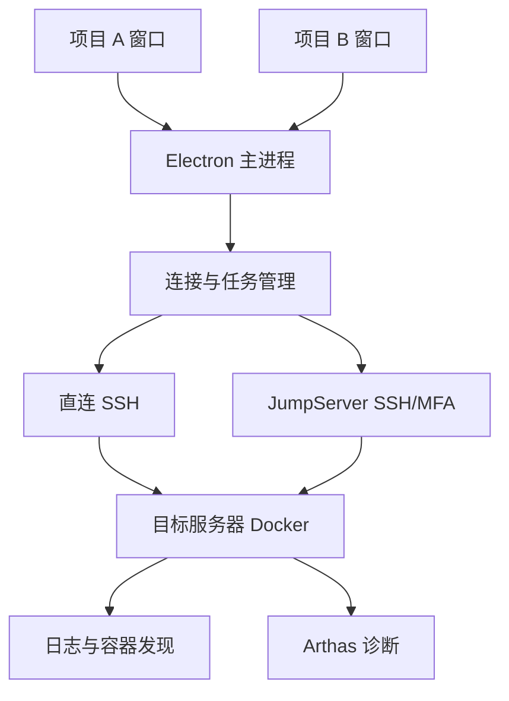

# TraceLogDock

[English](README.en.md) · [文档导航](docs/README.md) · [架构](docs/architecture.md) · [路线图](docs/roadmap.md)

面向多项目、多服务器 Java 微服务的桌面日志与 Arthas 诊断工作台。

> **私有项目，暂不开源，不接收外部贡献或 Issues。当前版本：0.3.20 加大日志框并随窗口高度扩展；默认先进入服务器配置，SERVICES列表支持编辑/删除，保留时间范围、独立AI配置、Arthas运行源码与本地建议。** 支持 SSH 密码/私钥、主机身份确认、交互 MFA、内嵌终端、JumpServer 人工选机后的目标确认，以及 Docker 容器发现与多实例实时日志；同账号多目标可复用一次堡垒机登录（需服务端允许多通道）。新增 JVM 发现、Arthas 4.0.5 包探测/缺包下载接入、方法候选搜索、ClassLoader 模板执行和单实例停止。当前远程流程已在本地隔离 SSH 服务验证，实际JumpServer登录已确认，多通道复用、Docker引擎及JVM attach仍待实际部署验收。

## 为什么做这个工具

一个微服务可能有多个实例，分布在不同服务器；不同项目还可能分别使用 SSH 直连和 JumpServer。排查问题时，需要反复登录、寻找容器、跟随日志并启动 Arthas。

TraceLogDock 计划把这些操作放进桌面工作区：按项目打开窗口，按服务查看日志，按实例诊断方法，并保留每条结果的真实来源。

## 产品目标与当前状态

| 能力            | 开发目标                                         | 当前状态                                           |
| --------------- | ------------------------------------------------ | -------------------------------------------------- |
| 多项目工作区    | 多个项目窗口并排使用，窗口内管理多服务器         | 已实现                                             |
| 项目配置        | 项目、环境、服务器、服务与容器映射               | 已实现，配置保存到本机                             |
| 服务器连接      | SSH 密码/私钥及 JumpServer SSH/MFA/资产菜单      | 已实现密码/私钥/MFA与内嵌终端；JumpServer人工选机  |
| Docker 实例发现 | 发现容器，确认服务归组和节点身份                 | 已实现容器发现，手动确认服务关联                   |
| 实时日志        | 只看新日志、最近 N 行、按时间、多实例合并与筛选  | 已实现真实日志通道、实例筛选、暂停/停止/关键词过滤 |
| 方法诊断        | 方法候选搜索，trace/watch/monitor/stack 快捷入口 | 已实现缺包下载接入、候选搜索、执行和原始结果       |
| 任务管理        | 按实例查看状态，停止任务与处理断线               | 已实现独立诊断会话、停止/超时和未知状态            |
| macOS           | 首发平台                                         | 本地桌面启动与多窗口冒烟已通过                     |
| Windows         | 后续支持                                         | 尚未验证                                           |

## 直接下载安装

**不需要下载源码，也不需要Node.js或pnpm。** 在[发布页面](https://github.com/526008793/tracelogdock/releases/tag/v0.3.20)选择对应安装包：

| 系统                       | 直接下载                                                                                                                 | 安装方式                  |
| -------------------------- | ------------------------------------------------------------------------------------------------------------------------ | ------------------------- |
| Mac Apple Silicon（M系列） | [Mac DMG](https://github.com/526008793/tracelogdock/releases/download/v0.3.20/TraceLogDock-0.3.20-mac-arm64.dmg)         | 打开后把APP拖到“应用程序” |
| Windows x64                | [Windows安装向导](https://github.com/526008793/tracelogdock/releases/download/v0.3.20/TraceLogDock-Setup-0.3.20-x64.exe) | 双击exe并按向导安装       |

私有仓库下载需要登录有访问权限的GitHub账号。安装包由GitHub原生runner构建并验证后作为Release附件提供；不提交到源码目录。Mac尚未公证、Windows未配置发布者签名，当前为预览版。安装、升级、服务器配置与使用方法见[安装指南](docs/installation.md)，构建维护见[发布流程](docs/releasing.md)。

## 当前使用方式

1. 启动 APP，新建项目及环境，配置服务器地址、端口、用户和连接方式。
2. 点击服务器的“连接”，输入本次密码、选择私钥，或按服务器提示完成交互认证。首次连接核对主机指纹。
3. JumpServer 在内嵌终端中人工选机，再点击“确认已进入目标服务器”，核对显示的主机名。
4. 点击“发现容器”，手动关联当前服务，或编辑服务填写现有容器名。
5. 在日志页选择实例及范围，点击“开始日志”；每行保留服务器、容器与输出来源，可筛选、暂停显示、停止全部或单个实例。
6. 方法诊断页发现 JVM，选择真实 PID，填写容器内完整 Arthas 4.0.5 工具包目录并接入；搜索候选方法后预览/执行模板，按实例查看结果和停止，详见[Arthas 接入](docs/arthas.md)。
7. 打开其他项目，各窗口的连接和任务独立；关闭或重载工作区会清理其所属资源。

可在连接弹窗勾选“在此设备上记住密码”，认证成功后由系统加密保存；下次直接使用，也可点“忘记密码”清除。私钥口令和OTP不保存。停止没有获得远端确认时显示“状态未知”，不能据本地断线断言远端任务已结束。

不同项目可使用不同连接方式，同一项目也可混合配置。单个项目无需为每台服务器打开外部终端。

## 架构概览



当前使用 Electron、Vue 3、TypeScript、Zod、ssh2 和 xterm.js。主进程管理连接、凭据和任务，窗口通过受约束的 IPC 调用功能。详见[架构说明](docs/architecture.md)和[设计决策](docs/adr/README.md)。

## 开发准备

要求 Node.js 22.12 或更新的受支持版本、pnpm 10.28.1，以及 Git。

```bash
corepack enable
corepack prepare pnpm@10.28.1 --activate
pnpm install --frozen-lockfile
pnpm check
pnpm dev
```

部分 Node.js 安装方式不包含 Corepack，需要先按 pnpm 官方文档准备包管理器。`pnpm dev` 启动开发版，`pnpm build` 构建应用，`pnpm start` 打开已构建版本。`pnpm package:mac` 生成本机 ad-hoc 签名测试 APP；它不是已发布的正式安装包。参见[开发指南](docs/development.md)。

## 接入边界

- 使用已有账号和授权连接服务器；JumpServer 是否支持复用认证、并发通道和端口转发，需要在实际部署中验证。
- 可以读取 `docker logs` 不代表具备 `docker exec`、文件传输或 JVM attach 权限。
- Arthas 需在目标 JVM 中加载，首次接入需要工具包分发或镜像预置。
- `trace` 主要用于当前 JVM 内逐层诊断，不能自动替代分布式链路追踪，也不能恢复未采集的历史方法调用。
- SSH 断开或关闭本地窗口不能直接证明远程诊断已停止，任务状态需要核对。

## 维护方式

本项目目前采用私有仓库，仅由仓库所有者维护，不开放外部协作、Issues 或外部 Pull Request。开发规范见[开发指南](docs/development.md)，阶段安排见[路线图](docs/roadmap.md)，安全问题处理见[安全说明](SECURITY.md)。

仓库虽为私有，文档和示例仍使用虚构项目、保留示例地址及无效凭据引用，不提交生产配置、终端截图、私钥或实际日志。

## 权利说明与致谢

本项目暂不开源，保留所有权利，使用限制见 [LICENSE](LICENSE)。[第三方说明](THIRD_PARTY_NOTICES.md)记录已使用的开发工具与计划集成组件。Arthas、JumpServer、Docker 等名称属于各自项目；本项目为独立工具，与这些项目不存在官方隶属关系。
