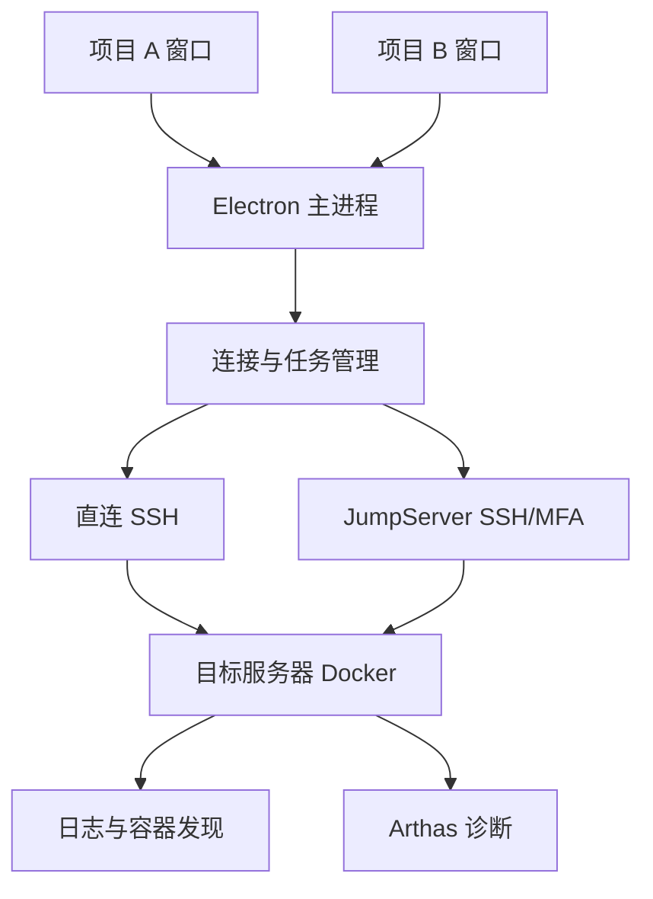

# TraceLogDock

[English](README.en.md) · [文档导航](docs/README.md) · [架构](docs/architecture.md) · [路线图](docs/roadmap.md)

面向多项目、多服务器 Java 微服务的桌面日志与 Arthas 诊断工作台。

> **私有项目，暂不开源，不接收外部贡献或 Issues。当前阶段：文档与工程规范初始化。** 本仓库尚未实现桌面 APP、SSH 连接或 Arthas 自动化，没有可下载安装包。下面的产品功能均为开发目标；`pnpm install` 安装的是文档检查工具。

## 为什么做这个工具

一个微服务可能有多个实例，分布在不同服务器；不同项目还可能分别使用 SSH 直连和 JumpServer。排查问题时，需要反复登录、寻找容器、跟随日志并启动 Arthas。

TraceLogDock 计划把这些操作放进桌面工作区：按项目打开窗口，按服务查看日志，按实例诊断方法，并保留每条结果的真实来源。

## 产品目标与当前状态

| 能力            | 开发目标                                         | 当前状态             |
| --------------- | ------------------------------------------------ | -------------------- |
| 多项目工作区    | 多个项目窗口并排使用，窗口内管理多服务器         | 已设计，待实现       |
| 服务器连接      | SSH 密码/私钥及 JumpServer SSH/MFA/资产菜单      | 已设计，待验证与实现 |
| Docker 实例发现 | 发现容器，确认服务归组和节点身份                 | 已设计，待实现       |
| 实时日志        | 只看新日志、最近 N 行、按时间、多实例合并与筛选  | 已设计，待实现       |
| 方法诊断        | 方法候选搜索，trace/watch/monitor/stack 快捷入口 | 已设计，待实现       |
| 任务管理        | 按实例查看状态，停止任务与处理断线               | 已设计，待实现       |
| macOS           | 首发平台                                         | 待实现与打包         |
| Windows         | 后续支持                                         | 路线图阶段           |

## 预期使用方式

1. 创建项目和环境，配置直连 SSH 或 JumpServer 服务器。
2. 连接后发现 Docker 容器，确认容器与微服务的对应关系。
3. 选择服务，合并查看所选节点日志，每条日志保留实例和服务器标识。
4. 输入方法名，选择真实类、方法及 ClassLoader，再执行诊断模板。
5. 在任务栏查看各节点状态，按需停止；其他项目窗口继续运行。

不同项目可使用不同连接方式，同一项目也可混合配置。单个项目无需为每台服务器打开外部终端。

## 架构概览



技术方向为 Electron、Vue 3、TypeScript、ssh2、xterm.js。主进程管理连接、凭据和任务，窗口通过受约束的 IPC 调用功能。详见[架构说明](docs/architecture.md)和[设计决策](docs/adr/README.md)。

## 开发准备

要求 Node.js 22 或更新的受支持版本、pnpm 10.28.1，以及 Git。

```bash
corepack enable
corepack prepare pnpm@10.28.1 --activate
pnpm install --frozen-lockfile
pnpm check
```

部分 Node.js 安装方式不包含 Corepack，需要先按 pnpm 官方文档准备包管理器。当前没有 `pnpm dev` 或 APP 构建命令；开发入口将在实际应用骨架加入时同步文档。参见[开发指南](docs/development.md)。

## 接入边界

- 使用已有账号和授权连接服务器；JumpServer 是否支持复用认证、并发通道和端口转发，需要在实际部署中验证。
- 可以读取 `docker logs` 不代表具备 `docker exec`、文件传输或 JVM attach 权限。
- Arthas 需在目标 JVM 中加载，首次接入需要工具包分发或镜像预置。
- `trace` 主要用于当前 JVM 内逐层诊断，不能自动替代分布式链路追踪，也不能恢复未采集的历史方法调用。
- SSH 断开或关闭本地窗口不能直接证明远程诊断已停止，任务状态需要核对。

## 维护方式

本项目目前采用私有仓库，仅由仓库所有者维护，不开放外部协作、Issues 或外部 Pull Request。开发规范见[开发指南](docs/development.md)，阶段安排见[路线图](docs/roadmap.md)，安全问题处理见[安全说明](SECURITY.md)。

仓库虽为私有，文档和示例仍使用虚构项目、保留示例地址及无效凭据引用，不提交生产配置、终端截图、私钥或实际日志。

## 权利说明与致谢

本项目暂不开源，保留所有权利，使用限制见 [LICENSE](LICENSE)。[第三方说明](THIRD_PARTY_NOTICES.md)记录已使用的开发工具与计划集成组件。Arthas、JumpServer、Docker 等名称属于各自项目；本项目为独立工具，与这些项目不存在官方隶属关系。
