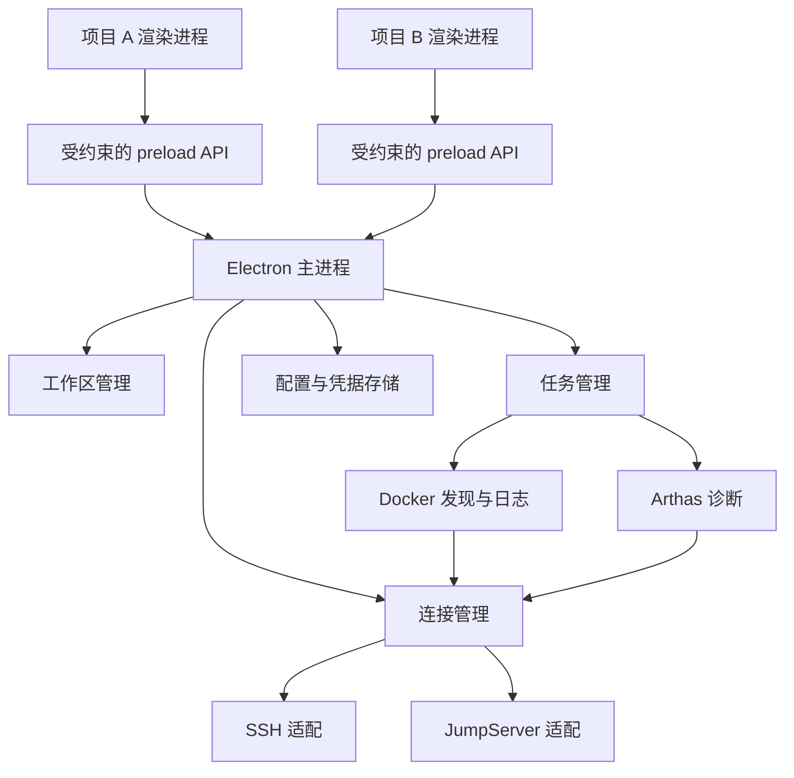
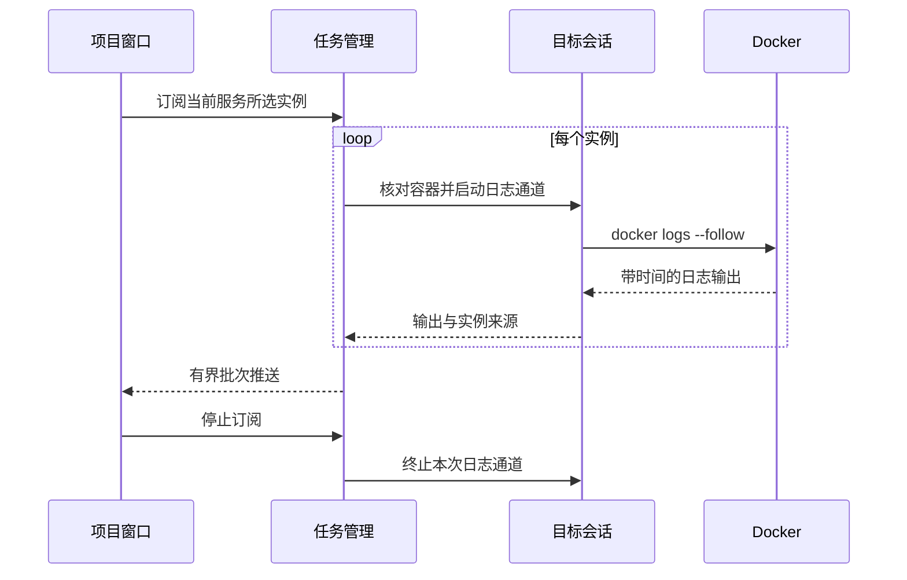
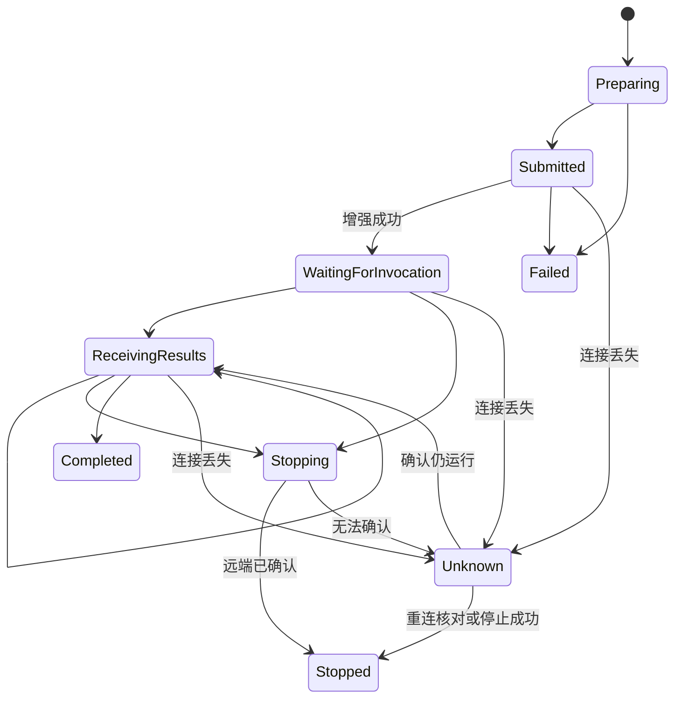

# 架构说明

## 状态与原则

这是目标架构，当前尚未实现应用代码。首期使用本地 Electron APP，按项目打开工作区，连接管理和远程任务在主进程执行。共享的是能力实现，项目、凭据和任务归属保持明确。

## 进程与模块



| 模块        | 职责                                                   |
| ----------- | ------------------------------------------------------ |
| 工作区管理  | 建立窗口与项目/环境的绑定，管理窗口生命周期            |
| 配置管理    | 保存版本化项目配置、服务器及服务映射                   |
| 凭据管理    | 使用系统支持的加密机制保存秘密，向连接模块提供所需认证 |
| 连接管理    | 认证、服务器会话、独立执行通道、流、中断和关闭         |
| Docker 适配 | 容器发现、实例身份核对、日志流                         |
| Arthas 适配 | 工具包探测、JVM 选择、候选方法、命令与结果             |
| 任务管理    | 拆分多实例任务、订阅结果、停止及断线后的核对           |

渲染进程不获得通用 shell 执行接口、完整凭据或任意文件访问能力。启用上下文隔离，关闭 Node 集成；preload 只暴露明确的业务操作。主进程根据调用窗口核对项目归属，不能只信任界面传来的 projectId。

## 数据归属

```text
Project
└─ Environment
   ├─ Servers → ConnectionProfile → SSH / JumpServer
   └─ Services
      └─ Instances → Server + ContainerId + StartedAt + JVM identity

Workspace → Project + selected Environment
Task → Workspace + Project + Environment + selected Instances
Subscription → Task or log view + source identity
```

窗口、项目、环境、服务器、实例和任务分别有自己的标识。不能使用全局可变的 currentProject 执行所有窗口的操作。容器重启可能保留 ID，重建可能复用名称，因此需要启动代次和 JVM 身份核对。

## 连接适配边界

上层需要的能力是连接到目标服务器、执行短命令、建立独立 PTY/流、发送任务中断以及释放通道。SSH 与 JumpServer 适配实现这些能力，但不伪装成所有部署都支持相同协议。

- 直连 SSH 优先使用 exec 通道执行短命令，PTY 用于交互命令。
- JumpServer 可能只允许交互式 shell，需处理资产菜单和可能的账号选择。
- 实际通道能力必须探测并记录；无法执行的操作返回明确原因。
- 一个连接是否能共享多个通道由目标部署决定，多连接可能再次触发 MFA。

连接池键不能仅是服务器显示名。只有身份、目标、连接配置和权限范围一致时才能考虑复用；连接的生命周期跟随实际使用者。一个工作区关闭不能终止其他使用者的通道。

## 日志数据流



日志保留项目、环境、实例、服务器和输出来源。多节点按时间窗口合并，不承诺严格全序。界面缓冲与 IPC 推送有界；暂停显示不同于停止远程订阅，见[日志设计](docker-logs.md)。

## 诊断任务生命周期



这是单实例任务状态。多个实例组成的上层任务聚合各自状态，允许部分失败。重连只恢复连接和核对，不自动重放 trace/watch 等有状态操作。

停止命令后，只有确认远端状态才能显示已停止。APP 被强杀时本地计时器无效；如需到期保证远端结束，必须先验证实际远端终止机制，不能只依靠 `-n` 或关闭 socket。

## 持久化与日志

项目配置采用带 schemaVersion 的本地 JSON。凭据单独加密，配置仅存引用；safeStorage 不可用时不降级明文保存。macOS 与 Windows 的底层保护和迁移差异需要发布前验证。

诊断结果默认只在内存展示，不默认长期保存参数和返回值。应用自身日志记录任务标识、状态转换和可定位的错误，不能记录密码、私钥、OTP 或未经处理的业务对象。

## 推荐代码布局

以下是未来实现布局，不代表当前目录已有应用代码：

```text
src/
├─ main/
│  ├─ workspaces/
│  ├─ connections/{ssh,jumpserver}/
│  ├─ docker/
│  ├─ arthas/
│  ├─ tasks/
│  └─ storage/
├─ preload/
├─ renderer/
└─ shared/
```

不先拆分微服务或建立多包仓库。只有出现清晰复用边界时再调整。相关依据见[架构决策](adr/README.md)。
