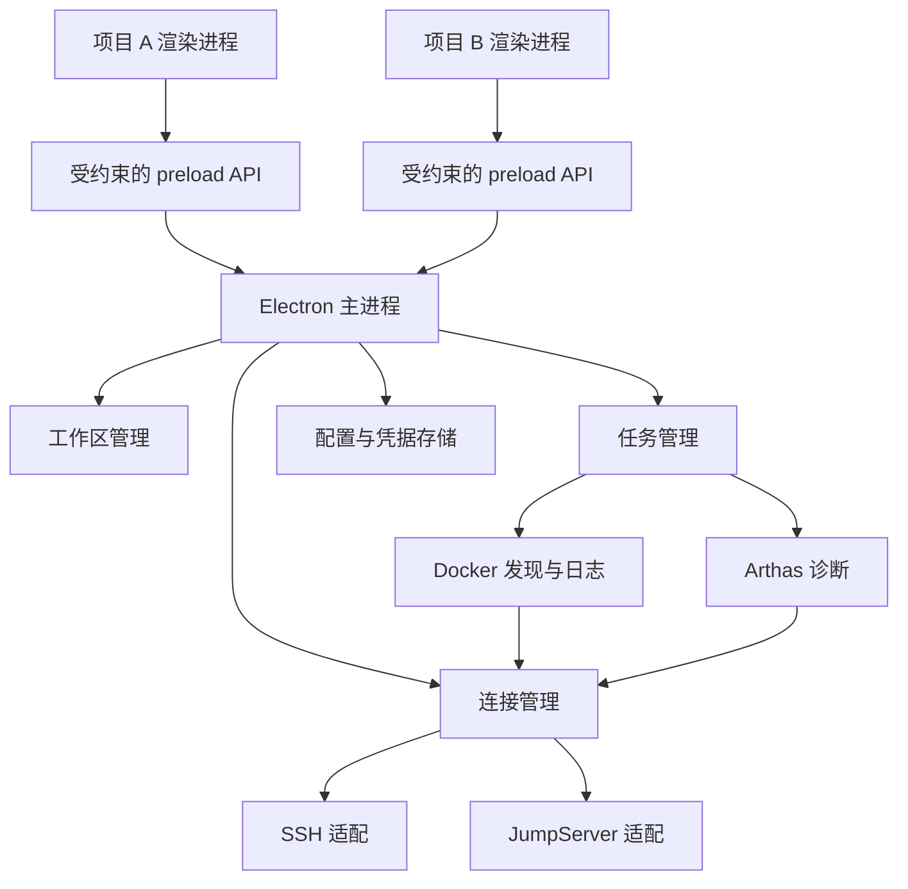
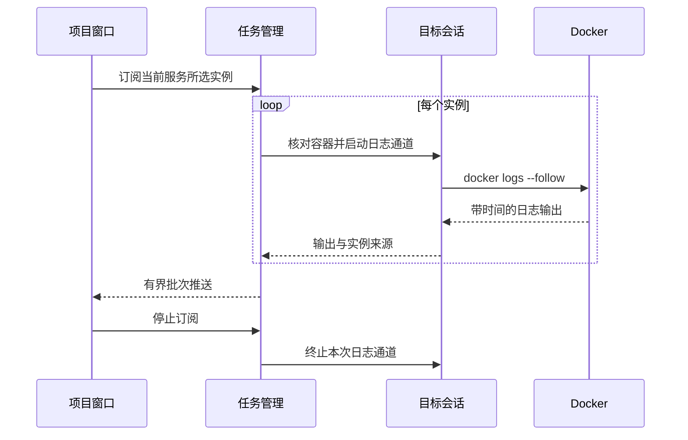
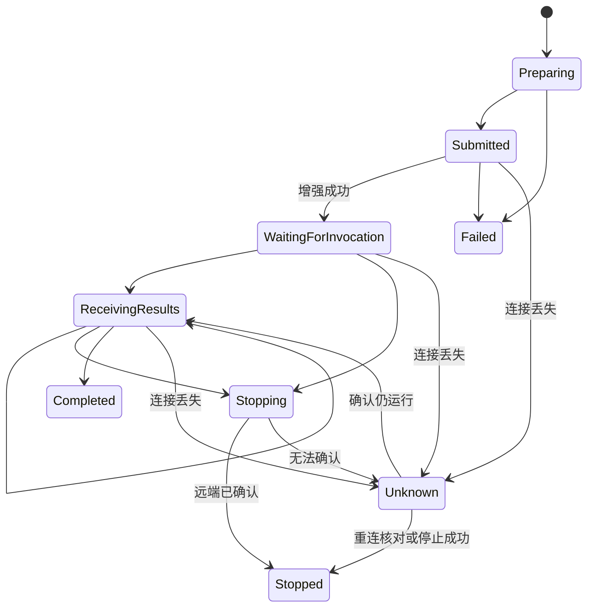

# 架构说明

## 状态与原则

这是分阶段架构。0.3.0 已实现工作区、配置、IPC、SSH/MFA、终端及 Docker 日志。已加入 Arthas 包探测/缺包下载诊断及可选的系统加密密码保存。首期使用本地 Electron APP，按项目打开工作区，连接管理和远程任务在主进程执行。共享的是能力实现，项目、凭据和任务归属保持明确。

## 进程与模块



| 模块        | 职责                                                   |
| ----------- | ------------------------------------------------------ |
| 工作区管理  | 建立窗口与项目/环境的绑定，管理窗口生命周期            |
| 配置管理    | 保存版本化项目配置、服务器及服务映射                   |
| 凭据管理    | 使用系统支持的加密机制保存秘密，向连接模块提供所需认证 |
| 连接管理    | 认证、服务器会话、独立执行通道、流、中断和关闭         |
| Docker 适配 | 容器发现、实例身份核对、日志流                         |
| Arthas 适配 | 工具包探测、JVM 选择、候选方法、命令与结果             |
| 任务管理    | 拆分多实例任务、订阅结果、停止及断线后的核对           |

渲染进程不获得任意文件访问或脱离会话的通用 shell 执行接口。连接输入由用户在界面短暂填写并提交，私钥内容仅在主进程读取，交互输入严格绑定当前窗口拥有的会话。启用上下文隔离，关闭 Node 集成；preload 只暴露明确的业务操作。主进程根据调用窗口核对项目归属，不能只信任界面传来的 projectId。

## 数据归属

```text
Project
└─ Environment
   ├─ Servers → ConnectionProfile → SSH / JumpServer
   └─ Services
      └─ Instances → Server + ContainerId + StartedAt + JVM identity

Workspace → Project + selected Environment
Task → Workspace + Project + Environment + selected Instances
Subscription → Task or log view + source identity
```

窗口、项目、环境、服务器、实例和任务分别有自己的标识。不能使用全局可变的 currentProject 执行所有窗口的操作。容器重启可能保留 ID，重建可能复用名称，因此需要启动代次和 JVM 身份核对。

## 连接适配边界

上层需要的能力是连接到目标服务器、执行短命令、建立独立 PTY/流、发送任务中断以及释放通道。SSH 与 JumpServer 适配实现这些能力，但不伪装成所有部署都支持相同协议。

- 直连 SSH 优先使用 exec 通道执行短命令，PTY 用于交互命令。
- JumpServer 可能只允许交互式 shell，需处理资产菜单和可能的账号选择。
- 实际通道能力必须探测并记录；无法执行的操作返回明确原因。
- 一个连接是否能共享多个通道由目标部署决定，多连接可能再次触发 MFA。

连接池键不能仅是服务器显示名。只有身份、目标、连接配置和权限范围一致时才能考虑复用；连接的生命周期跟随实际使用者。一个工作区关闭不能终止其他使用者的通道。

## 日志数据流



日志保留项目、环境、实例、服务器和输出来源。多节点按时间窗口合并，不承诺严格全序。界面缓冲与 IPC 推送有界；暂停显示不同于停止远程订阅，见[日志设计](docker-logs.md)。

## 诊断任务生命周期



这是单实例任务状态。多个实例组成的上层任务聚合各自状态，允许部分失败。重连只恢复连接和核对，不自动重放 trace/watch 等有状态操作。

停止命令后，只有确认远端状态才能显示已停止。APP 被强杀时本地计时器无效；如需到期保证远端结束，必须先验证实际远端终止机制，不能只依靠 `-n` 或关闭 socket。

## 持久化与日志

项目配置采用 schemaVersion=1 的本地 JSON，通过单例主进程的写队列及临时文件原子替换持久化。项目 revision 用于拒绝旧窗口覆盖新配置；文件损坏时报告错误，不初始化覆盖。未选择记住的连接凭据只保留内存，不写入项目配置。主机信任单独存于 known-hosts.json。PasswordStore使用safeStorage加密密码，独立原子写入passwords.json，项目/环境和端点账号共同绑定；只有SSH成功事件才提交待保存密文，失败或关闭清除待保存记录，忘记操作会先取消并发认证中的保存。safeStorage不可用时不降级明文保存，renderer无取回明文的API。macOS 与 Windows 的底层保护和迁移差异需要发布前验证。

诊断结果默认只在内存展示，不默认长期保存参数和返回值。应用自身日志记录任务标识、状态转换和可定位的错误，不能记录密码、私钥、OTP 或未经处理的业务对象。

## 推荐代码布局

当前代码布局如下：

```text
src/
├─ main/
│  ├─ index.ts
│  ├─ connections/
│  ├─ docker/
│  ├─ arthas/
│  ├─ workspaces/
│  └─ storage/
├─ preload/
├─ renderer/
└─ shared/
```

不先拆分微服务或建立多包仓库。只有出现清晰复用边界时再调整。相关依据见[架构决策](adr/README.md)。

## 已实现的窗口隔离

主进程通过 webContents ID 绑定工作区上下文。工作区只能列出或保存自己的项目，创建和删除项目仅允许项目管理窗口。项目配置改变时广播变更通知，各窗口重新读取本范围内的数据；同一项目已有窗口时再次打开只聚焦原窗口。具体实现见 src/main/workspaces/context-registry.ts 与 src/main/index.ts。

## 连接与日志实现

RemoteController 在每次远程操作前从本机项目配置解析目标，核对当前窗口项目；不信任前端传入的 host 或任意路径。SessionManager 管理主机信任、交互认证和连接，DockerService 管理容器发现、身份核对、日志任务及批量输出。

JumpServer 的 FramedShell 采用随机标记，从实际执行输出而非输入回显中识别结果；一个 shell 排他使用，不假定支持多目标通道。直连 SSH 则使用独立 exec。任务和连接均按工作区隔离，配置删除/修改会清理受影响资源。

## Arthas 工具包与接入实现

ArthasService 通过容器内 curl 调用 loopback HTTP API。JVM 选择绑定工作区、连接 ID、容器 ID/StartedAt、PID/startTicks 和 UID；执行前重新核对身份。工具包固定验证 4.0.5，缺包时按 JVM UID 从 Maven Central 下载可执行官方启动 JAR并校验固定 SHA-256；已有完整包或boot JAR直接复用。仅boot模式通过--use-version 4.0.5固定依赖，由启动器使用Java下载/解压，不依赖系统unzip。启动器缓存限定到所选目录，JAR下载和首次启动分别使用150秒命令超时，完成后再次检查容器/JVM及工作区有效性。attach 后通过 version/session 核对版本与 javaPid，不全局停止 agent。

方法搜索使用业务包限定的 sm -d，候选包含完整类名、描述符、参数和 ClassLoader。每个任务独立 init_session/async_exec/pull_results，停止发送 interrupt_job 并核对 jobId/TERMINATED，最后 close_session。最长运行时间依靠应用计时器请求中断；未知状态保留，掉线后无自动恢复。界面每任务保留最近200条结果，只存在内存中。

窗口激活：打开项目后隐藏manager，现有工作区按focus事件维护最近顺序。Dock activate和second-instance复用同一入口，优先restore/show/focus最近现有工作区；无工作区时通过ProjectStore.lastOpenedProject读取可选lastOpenedProjectId，启动时同样恢复。openProject使用现有原子队列保存最近选择，项目revision不变；新窗口ready-to-show后才隐藏首页，防止加载期间无可见入口。原生窗口拦截通用HTML标题更新，保留项目名称。

多层追踪通过arthas:scope解析当前JVM/同一ClassLoader下的明确类与方法名组合；只读枚举可用methods=*，实际执行只采用解析出的具体方法。diagnosticSchema新增trace-multi与scope元数据，主进程在init_session前重新解析并比较完整签名集合，拒绝范围变化或遗漏重载。命令的原始类/方法使用字面量正则，排除集合外子类；输出条件绑定最外层入口类/方法，无#cost阈值。入口与扩展候选分离，修改范围/入口/连接后必须重新核对。
